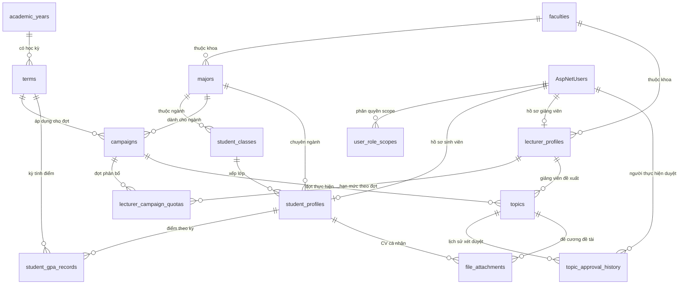

<div align="center">
  
  <h1>Hệ thống quản lý thực tập và đồ án sinh viên</h1>
  <p><strong>Trường Đại học Vinh · Nhóm N10 · Đề tài 36</strong></p>
  <p>Đồ án học phần Công nghệ phần mềm — Bản local đối chiếu backlog Sprint 1–2</p>
  <p>ASP.NET Core MVC · .NET 10 · Entity Framework Core · MySQL 8 · Bootstrap 5</p>
</div>

> **Cập nhật local theo backlog:** bổ sung mật khẩu, phân quyền hồ sơ/CV, Excel, danh mục học vụ, doanh nghiệp, lịch/điều kiện và kiểm soát quota. Xem [hướng dẫn và đối chiếu issue](docs/BACKLOG_LOCAL.md) và [ERD](docs/ERD.md). Cần nhập thêm hai script trong `database/migrations/` sau bản SQL nền trước khi chạy bản này. Cấu hình lịch đợt trước khi tạo/sửa/gửi đề tài.

---

<a id="gioi-thieu"></a>
## 1. Giới thiệu đề tài

Thực tập và đồ án là những hoạt động quan trọng trong quá trình đào tạo sinh viên, có sự phối hợp giữa phòng đào tạo, khoa/ngành, giảng viên, sinh viên và doanh nghiệp. Việc tổ chức các đợt, quản lý tài khoản, quản lý hồ sơ chuyên môn và xét duyệt đề tài trực tuyến là nền tảng cốt lõi để theo dõi quá trình thực hiện một cách thống nhất, minh bạch.

**Hệ thống quản lý thực tập và đồ án sinh viên** được nhóm N10 xây dựng trong khuôn khổ đề tài 36, học phần Công nghệ phần mềm. Hệ thống được triển khai trên nền tảng ASP.NET Core 10 MVC, kết nối cơ sở dữ liệu MySQL 8 (`ql_thuctap_doan`), kế thừa nhận diện cổng USMART Trường Đại học Vinh.

---

### Mục lục

- [1. Giới thiệu đề tài](#gioi-thieu)
- [2. Tổng quan các Sprint đã hoàn thành](#tong-quan-sprint)
- [3. Chức năng chi tiết Sprint 2](#chuc-nang-sprint-2)
  - [US-07: Quản lý hồ sơ sinh viên](#us-07)
  - [US-08: Quản lý hồ sơ giảng viên & Hạn mức theo đợt](#us-08)
  - [US-10: Giảng viên đăng ký đề tài](#us-10)
  - [US-11: Cán bộ khoa xét duyệt đề tài](#us-11)
- [4. Cơ sở dữ liệu MySQL (21 bảng)](#co-so-du-lieu)
- [5. Kiến trúc bảo mật & Lưu trữ tài liệu](#bao-mat)
- [6. Cài đặt và chạy dự án](#cai-dat)
- [7. Danh sách tài khoản thử nghiệm](#tai-khoan)
- [8. Kết quả kiểm thử Sprint 2](#kiem-thu)
- [9. Kịch bản trình diễn trước giảng viên](#demo)
- [10. Hướng phát triển Sprint 3](#phat-trien)

---

<a id="tong-quan-sprint"></a>
## 2. Tổng quan các Sprint đã hoàn thành

### Sprint 1: Nền tảng xác thực, phân quyền & Quản lý đợt
- **US-01: Đăng nhập & Đăng xuất:** Xác thực Identity, bảo mật cookie `.VinhUni.Internship.Auth`, tự động điều hướng theo vai trò, chống brute-force (khóa 15 phút sau 5 lần nhập sai).
- **US-02: Quản lý tài khoản (Admin):** CRUD người dùng, phân trang, tìm kiếm, lọc theo vai trò, toggle khóa/mở khóa, bảo vệ Admin cuối cùng.
- **US-03: Phân quyền theo phạm vi (Scope-based Authorization):** Tích hợp bảng `user_role_scopes` với 4 cấp độ: `GLOBAL` (Toàn trường), `FACULTY` (Khoa), `MAJOR` (Ngành), `CAMPAIGN` (Đợt cụ thể).
- **US-05: Quản lý đợt thực tập / đồ án:** Khởi tạo và quản lý đợt, kiểm tra trùng mã, kiểm tra ngày kết thúc sau ngày bắt đầu, chuyển đổi trạng thái: `DRAFT` $\rightarrow$ `OPEN` $\rightarrow$ `CLOSED` $\rightarrow$ `ARCHIVED`.

### Sprint 2: Quản lý hồ sơ & Quy trình đăng ký, xét duyệt đề tài
- **US-07: Quản lý hồ sơ sinh viên:** Xem thông tin học vụ, điểm GPA tích lũy, cập nhật kỹ năng chuyên môn, hướng quan tâm, tải lên và quản lý CV cá nhân an toàn.
- **US-08: Quản lý hồ sơ giảng viên:** Xem và cập nhật học hàm, học vị, bộ môn, chuyên môn, hướng nghiên cứu; Cán bộ quản lý phân bổ hạn mức hướng dẫn sinh viên theo đợt.
- **US-10: Giảng viên đăng ký đề tài:** Quản lý đề tài của tôi, tạo đề tài (bản nháp hoặc gửi duyệt ngay), chỉnh sửa đề tài nháp/yêu cầu sửa, đính kèm đề cương chi tiết, theo dõi phản hồi.
- **US-11: Cán bộ khoa xét duyệt đề tài:** Lọc danh sách đề tài chờ duyệt theo phạm vi khoa/ngành được cấp, xem chi tiết đề tài, phê duyệt (`APPROVE`), yêu cầu chỉnh sửa (`REQUEST_REVISION` bắt buộc nhận xét), từ chối (`REJECT`), sinh viên xem danh mục đề tài đã duyệt.

---

<a id="chuc-nang-sprint-2"></a>
## 3. Chức năng chi tiết Sprint 2

<a id="us-07"></a>
### US-07 — Quản lý hồ sơ sinh viên
- **Xem hồ sơ cá nhân:** Hiển thị đầy đủ Mã sinh viên, Họ tên, Email, Lớp sinh hoạt, Ngành, Khoa, Điểm GPA thang 4 và thang 10 theo học kỳ, Kỹ năng và Lĩnh vực quan tâm.
- **Cập nhật thông tin được phép:** Sinh viên chỉ được chỉnh sửa Kỹ năng chuyên môn, Hướng nghiên cứu quan tâm và Tệp tin CV.
- **Bảo vệ toàn vẹn dữ liệu học vụ:** Mã sinh viên, Lớp, Ngành và GPA chính thức không thể bị chỉnh sửa hay can thiệp qua HTTP request tampering.
- **Tải lên và tải xuống CV:** Hỗ trợ định dạng `.pdf`, `.doc`, `.docx` dung lượng tối đa 10MB. File được lưu trữ an toàn và chỉ có sinh viên sở hữu hoặc cán bộ/giảng viên có thẩm quyền mới được phép tải về.

<a id="us-08"></a>
### US-08 — Quản lý hồ sơ giảng viên & Hạn mức theo đợt
- **Hồ sơ chuyên môn giảng viên:** Hiển thị Mã giảng viên, Họ tên, Email, Khoa trực thuộc, Bộ môn, Học vị (ThS, TS...), Học hàm (PGS, GS...), Lĩnh vực chuyên môn và Hướng nghiên cứu.
- **Chỉnh sửa hồ sơ:** Giảng viên được phép cập nhật Học vị, Học hàm, Bộ môn, Chuyên môn và Hướng nghiên cứu.
- **Bảo vệ trường quản trị:** Mã giảng viên và Khoa trực thuộc do Admin quản lý; Giảng viên không thể tự ý tăng hạn mức hướng dẫn.
- **Phân bổ hạn mức theo từng đợt (`lecturer_campaign_quotas`):** Cán bộ khoa/đào tạo có thẩm quyền thiết lập số sinh viên tối đa (`max_students`) mà mỗi giảng viên được hướng dẫn trong từng đợt cụ thể.

<a id="us-10"></a>
### US-10 — Giảng viên đăng ký đề tài
- **Quản lý đề tài cá nhân:** Giảng viên theo dõi danh sách tất cả đề tài do mình đăng ký theo từng đợt, lọc theo trạng thái đề tài và tìm kiếm nhanh.
- **Khởi tạo đề tài:** Nhập Mã đề tài, Tên đề tài, Mục tiêu, Yêu cầu kiến thức, Công nghệ sử dụng, Lĩnh vực nghiên cứu, Số lượng sinh viên tối đa ($\ge 1$), đính kèm tệp đề cương chi tiết.
- **Tùy chọn lưu nháp hoặc gửi duyệt ngay:** Hỗ trợ lưu `DRAFT` để bổ sung sau hoặc gửi `PENDING` đến cán bộ khoa.
- **Chỉnh sửa an toàn:** Chỉ cho phép sửa đề tài ở trạng thái `DRAFT` hoặc `REVISION_REQUIRED`. Đề tài đã được phê duyệt (`APPROVED`) không thể tùy tiện sửa đổi trực tiếp.
- **Kiểm tra trùng mã đề tài:** Kiểm tra ràng buộc duy nhất `(campaign_id, code)` trong cùng một đợt.

<a id="us-11"></a>
### US-11 — Cán bộ khoa xét duyệt đề tài
- **Lọc đề tài theo phạm vi quản lý:** Cán bộ chỉ xét duyệt các đề tài thuộc đợt/ngành/khoa mà mình được cấp quyền trong `user_role_scopes`. Cán bộ Khoa Kinh tế không thể xem hoặc duyệt đề tài của Khoa Công nghệ Thông tin.
- **Màn hình xét duyệt chi tiết:** Hiển thị toàn bộ thông tin đề tài, giảng viên đề xuất, tệp đề cương đính kèm và toàn bộ dòng thời gian lịch sử xét duyệt trước đó.
- **Ba hành động xét duyệt nghiệp vụ:**
  1. **Phê duyệt (`APPROVE`):** Đề tài chuyển sang `APPROVED`, ghi nhận thời gian `approved_at = NOW()`, sinh viên bắt đầu nhìn thấy đề tài.
  2. **Yêu cầu chỉnh sửa (`REQUEST_REVISION`):** Bắt buộc nhập ý kiến phản hồi cụ thể, đề tài chuyển sang `REVISION_REQUIRED`. Giảng viên nhận được phản hồi và có thể chỉnh sửa để gửi lại.
  3. **Từ chối (`REJECT`):** Bắt buộc nhập lý do từ chối, đề tài chuyển sang `REJECTED`.
- **Ghi nhận lịch sử xét duyệt (`topic_approval_history`):** Lưu trữ chính xác người thực hiện, hành động (`SUBMIT`, `RESUBMIT`, `REQUEST_REVISION`, `APPROVE`, `REJECT`), trạng thái cũ, trạng thái mới, nội dung nhận xét và dấu thời gian.
- **Công bố cho sinh viên (`/Topics/Approved`):** Sinh viên chỉ xem được các đề tài đã `APPROVED`; đề tài `DRAFT`, `PENDING` hay `REJECTED` tuyệt đối không bị lộ.

---

<a id="co-so-du-lieu"></a>
## 4. Cơ sở dữ liệu MySQL (21 bảng)

Database: **`ql_thuctap_doan`** (MySQL 8, InnoDB, UTF-8 MB4).



### Danh mục 21 bảng trong CSDL

| STT | Tên bảng | Nhóm | Mô tả chức năng |
| :---: | :--- | :--- | :--- |
| 1 | `AspNetUsers` | Identity | Thông tin tài khoản, mật khẩu hash, trạng thái hoạt động |
| 2 | `AspNetRoles` | Identity | Danh mục vai trò (`Admin`, `TrainingManager`, `FacultyManager`, `Lecturer`, `Student`, `Company`) |
| 3 | `AspNetUserRoles` | Identity | Liên kết tài khoản – vai trò |
| 4 | `AspNetUserClaims` | Identity | Claims người dùng |
| 5 | `AspNetRoleClaims` | Identity | Claims vai trò |
| 6 | `AspNetUserLogins` | Identity | Đăng nhập liên kết ngoài |
| 7 | `AspNetUserTokens` | Identity | Token xác thực, đặt lại mật khẩu |
| 8 | `faculties` | Nghiệp vụ S1 | Danh mục khoa / viện |
| 9 | `majors` | Nghiệp vụ S1 | Danh mục ngành đào tạo |
| 10 | `academic_years` | Nghiệp vụ S1 | Danh mục năm học |
| 11 | `terms` | Nghiệp vụ S1 | Danh mục học kỳ trong năm học |
| 12 | `campaigns` | Nghiệp vụ S1 | Đợt thực tập / đồ án tốt nghiệp |
| 13 | `user_role_scopes` | Nghiệp vụ S1 | Phân quyền theo phạm vi (`GLOBAL`, `FACULTY`, `MAJOR`, `CAMPAIGN`) |
| 14 | `student_classes` | Nghiệp vụ S2 | Danh mục lớp sinh hoạt của sinh viên |
| 15 | `student_profiles` | Nghiệp vụ S2 | Hồ sơ sinh viên, kỹ năng, lĩnh vực quan tâm |
| 16 | `student_gpa_records` | Nghiệp vụ S2 | Lịch sử điểm GPA thang 4 và thang 10 theo từng học kỳ |
| 17 | `lecturer_profiles` | Nghiệp vụ S2 | Hồ sơ giảng viên, học hàm, học vị, chuyên môn, hướng nghiên cứu |
| 18 | `lecturer_campaign_quotas`| Nghiệp vụ S2 | Hạn mức số lượng sinh viên hướng dẫn của giảng viên theo từng đợt |
| 19 | `topics` | Nghiệp vụ S2 | Đề tài đồ án & thực tập, trạng thái xét duyệt, số SV tối đa |
| 20 | `topic_approval_history` | Nghiệp vụ S2 | Nhật ký lịch sử xét duyệt, hành động, trạng thái và ý kiến phản hồi |
| 21 | `file_attachments` | Nghiệp vụ S2 | Quản lý tệp CV sinh viên và tài liệu đề cương đề tài |

---

<a id="bao-mat"></a>
## 5. Kiến trúc bảo mật & Lưu trữ tài liệu

1. **Lưu trữ tệp ngoài thư mục công khai:** Tệp tin CV sinh viên và tài liệu đề cương đề tài được lưu trữ an toàn trong thư mục máy chủ nội bộ `App_Data/Uploads/` (bên ngoài `wwwroot`).
2. **Kiểm soát truy cập tải xuống qua Controller:** Không cung cấp đường link tệp tĩnh trực tiếp. Mọi yêu cầu tải tệp đều qua Action có xác thực bản quyền:
   - Sinh viên chỉ tải được CV của chính mình;
   - Sinh viên không thể tải tài liệu của các đề tài chưa được phê duyệt;
   - Cán bộ và giảng viên được xác thực trước khi truy cập tệp.
3. **Kiểm duyệt tệp tin:** Giới hạn định dạng cho phép (`.pdf`, `.doc`, `.docx`, `.zip`, `.rar`), giới hạn dung lượng tối đa 10MB, khử ký tự nguy hiểm và sinh mã định danh UUID chống tấn công Path Traversal.
4. **Bảo toàn giao diện tiếng Việt UTF-8:** Cấu hình `HtmlEncoder.Create(UnicodeRanges.All)` đảm bảo văn bản tiếng Việt xuất ra dưới dạng UTF-8 tự nhiên, hiển thị sắc nét trên mọi trình duyệt.

---

<a id="cai-dat"></a>
## 6. Cài đặt và chạy dự án

### Yêu cầu môi trường
- Hệ điều hành: Windows / Linux / macOS
- **.NET SDK 10** (`dotnet --version` hiển thị `10.x`)
- **MySQL Server 8.0** (cổng mặc định `3306`)

### Khởi chạy ứng dụng
Tại thư mục gốc của dự án, mở Terminal (PowerShell):

```powershell
# Di chuyển vào thư mục web
cd InternshipManagement.Web

# Khởi chạy ứng dụng tại cổng 5064
dotnet run --urls http://localhost:5064
```

Mở trình duyệt truy cập: **[http://localhost:5064](http://localhost:5064)**

---

<a id="tai-khoan"></a>
## 7. Danh sách tài khoản thử nghiệm

Hệ thống có cơ chế tự khởi tạo (`DbInitializer`) với các tài khoản thử nghiệm chuẩn hóa:

| Tên đăng nhập | Mật khẩu | Họ và tên | Vai trò (Role) | Phạm vi quản lý (Scope) / Ghi chú |
| :--- | :--- | :--- | :--- | :--- |
| **`admin`** | `Admin@123` | Quản trị viên Hệ thống | `Admin` | Toàn trường (`GLOBAL`) — Quản lý toàn bộ hệ thống |
| **`cb_daotao`** | `CanBo@123` | Trần Văn Cán Bộ | `TrainingManager` | Toàn trường (`GLOBAL`) — Quản lý đợt toàn trường |
| **`cb_cntt`** | `CanBo@123` | Lê Thị Cán Bộ CNTT | `FacultyManager` | Khoa CNTT (`FACULTY`) — Quản lý đợt & xét duyệt đề tài Khoa CNTT |
| **`cb_kinhte`** | `CanBo@123` | Cán bộ Khoa Kinh tế | `FacultyManager` | Khoa KTKD (`FACULTY`) — Quản lý đợt Khoa Kinh tế |
| **`giangvien`** | `Lecturer@123` | TS. Hoàng Minh Giảng Viên | `Lecturer` | Giảng viên hướng dẫn Khoa CNTT — Đăng ký đề tài |
| **`student`** | `Student@123` | Nguyễn Văn Sinh Viên | `Student` | Sinh viên Khóa 63 CNTT — Cập nhật hồ sơ & xem đề tài |

---

<a id="kiem-thu"></a>
## 8. Kết quả kiểm thử Sprint 2

Kịch bản kiểm thử tích hợp tự động toàn diện được cung cấp tại file **[`run_acceptance_tests_sprint2.py`](run_acceptance_tests_sprint2.py)**.

Để chạy bộ kiểm thử:
```powershell
python run_acceptance_tests_sprint2.py
```

### Bảng kết quả nghiệm thu chi tiết

| Mã Test | Nội dung kiểm tra | Tiêu chí chấp thuận (Acceptance Criteria) | Kết quả |
| :---: | :--- | :--- | :---: |
| **TC-01** | Kiểm tra đăng nhập Quản trị viên | Baseline US-01 — Đăng nhập cấp Cookie xác thực thành công | **PASS** |
| **TC-02** | Sinh viên xem hồ sơ học vụ & GPA | US-07 AC-1 — Hiển thị Mã SV, Lớp, Ngành, Điểm GPA thang 4 & 10 | **PASS** |
| **TC-03** | Sinh viên cập nhật kỹ năng, hướng quan tâm, tải CV | US-07 AC-2, AC-3 — Lưu vào MySQL, hiển thị tên tệp CV | **PASS** |
| **TC-04** | Kiểm soát quyền truy cập và tải file CV | US-07 AC-4, AC-6 — Sinh viên tải CV thành công, kiểm soát bảo mật | **PASS** |
| **TC-05** | Giảng viên xem hồ sơ chuyên môn | US-08 AC-1, AC-2 — Hiển thị Mã GV, Khoa, Hạn mức theo đợt | **PASS** |
| **TC-06** | Giảng viên cập nhật chuyên môn & hướng nghiên cứu | US-08 AC-1, AC-6 — Cập nhật học vị, học hàm, chuyên môn vào MySQL | **PASS** |
| **TC-07** | Cán bộ thiết lập hạn mức theo đợt cho giảng viên | US-08 AC-3, AC-4 — Phân bổ chỉ tiêu hướng dẫn theo đợt cụ thể | **PASS** |
| **TC-08** | Giảng viên tạo đề tài mới lưu bản nháp `DRAFT` | US-10 AC-1 — Tạo đề tài thành công với trạng thái Bản nháp | **PASS** |
| **TC-09** | Giảng viên chỉnh sửa bản nháp đề tài | US-10 AC-2 — Cho phép sửa nội dung khi ở trạng thái `DRAFT` | **PASS** |
| **TC-10** | Giảng viên gửi đề tài xét duyệt | US-10 AC-3, AC-4 — Chuyển trạng thái sang `PENDING`, ghi lịch sử | **PASS** |
| **TC-11** | Chặn sinh viên xem đề tài `PENDING` | US-10 AC-5, US-11 AC-6 — Đề tài chưa duyệt không hiển thị với sinh viên | **PASS** |
| **TC-12** | Cán bộ khoa thấy đề tài chờ duyệt trong phạm vi | US-11 AC-1, AC-2 — Cán bộ Khoa CNTT thấy đề tài thuộc khoa mình | **PASS** |
| **TC-13** | Cán bộ khoa yêu cầu chỉnh sửa đề tài có nhận xét | US-11 AC-4 — Chuyển `REVISION_REQUIRED`, lưu nhận xét phản hồi | **PASS** |
| **TC-14** | Giảng viên xem phản hồi và gửi lại xét duyệt | US-10 AC-6, AC-7 — Giảng viên xem nhận xét, cập nhật và gửi lại `PENDING` | **PASS** |
| **TC-15** | Chặn cán bộ ngoài phạm vi xét duyệt đề tài | US-11 AC-7 — Cán bộ Khoa Kinh tế không thể duyệt đề tài Khoa CNTT | **PASS** |
| **TC-16** | Cán bộ khoa có thẩm quyền phê duyệt đề tài | US-11 AC-3, AC-8 — Chuyển `APPROVED`, lưu `approved_at`, ghi lịch sử | **PASS** |
| **TC-17** | Sinh viên xem danh mục đề tài đã phê duyệt | US-11 AC-6 — Đề tài đã duyệt xuất hiện công khai trên cổng sinh viên | **PASS** |
| **TC-18** | Ràng buộc kiểm tra trùng mã đề tài cùng đợt | US-10 Rule — Hệ thống chặn tạo mã đề tài trùng lặp trong một đợt | **PASS** |

**Kết quả ban đầu:** 18 kịch bản trong bảng trên đã đạt. Bản local đối chiếu backlog đã mở rộng thành **21 kịch bản Sprint 2 và 8 nhóm kiểm tra backlog**, chạy trên bản sao CSDL riêng; kết quả và cách chạy xem [tài liệu local](docs/BACKLOG_LOCAL.md).

---

<a id="demo"></a>
## 9. Kịch bản trình diễn trước giảng viên (Sprint 2)

Thời lượng: **10 – 15 phút**.

1. **Bước 1 — Hồ sơ sinh viên & CV (US-07):**
   - Đăng nhập tài khoản `student` / `Student@123`.
   - Vào menu **Hồ sơ cá nhân**: quan sát mã sinh viên `2011060001`, bảng điểm GPA thang 4 và 10.
   - Nhấn **Cập nhật hồ sơ & CV**: cập nhật kỹ năng chuyên môn, lĩnh vực quan tâm và tải lên tệp CV mẫu (`.pdf`).
   - Tải về kiểm tra tệp CV đã nộp.
2. **Bước 2 — Hồ sơ chuyên môn giảng viên (US-08):**
   - Đăng xuất, đăng nhập tài khoản `giangvien` / `Lecturer@123`.
   - Vào menu **Hồ sơ giảng viên**: xem học vị, học hàm, chuyên môn và bảng hạn mức hướng dẫn.
   - Nhấn **Cập nhật hồ sơ chuyên môn** để lưu thông tin mới.
3. **Bước 3 — Giảng viên đăng ký đề tài (US-10):**
   - Vào **Quản lý đề tài $\rightarrow$ Đăng ký đề tài mới**.
   - Nhập thông tin đề tài, chọn lưu bản nháp (`DRAFT`).
   - Vào chi tiết đề tài, nhấn **Gửi xét duyệt** $\rightarrow$ Đề tài chuyển sang **Chờ xét duyệt** (`PENDING`).
4. **Bước 4 — Kiểm tra bảo mật sinh viên:**
   - Đăng nhập lại `student`, vào trang **Đề tài được phê duyệt** $\rightarrow$ Đề tài vừa tạo chưa xuất hiện (đảm bảo tính bảo mật).
5. **Bước 5 — Cán bộ khoa yêu cầu chỉnh sửa đề tài (US-11):**
   - Đăng nhập `cb_cntt` / `CanBo@123`.
   - Vào menu **Xét duyệt đề tài** $\rightarrow$ Thấy đề tài đang chờ duyệt.
   - Nhấn **Xem & Duyệt**, nhập nhận xét yêu cầu bổ sung kiến trúc và nhấn **Yêu cầu chỉnh sửa**.
6. **Bước 6 — Giảng viên sửa và gửi lại:**
   - Đăng nhập lại `giangvien`, mở chi tiết đề tài $\rightarrow$ Nhìn thấy khung cảnh báo màu vàng chứa nhận xét từ cán bộ khoa.
   - Nhấn **Chỉnh sửa**, cập nhật nội dung và nhấn **Lưu và gửi xét duyệt**.
7. **Bước 7 — Kiểm tra phân quyền Scope (US-03/US-11):**
   - Đăng nhập `cb_kinhte` / `CanBo@123` (Cán bộ Khoa Kinh tế).
   - Thử truy cập xét duyệt đề tài Khoa CNTT $\rightarrow$ Hệ thống từ chối truy cập do ngoài phạm vi quản lý.
8. **Bước 8 — Cán bộ Khoa CNTT phê duyệt đề tài:**
   - Đăng nhập lại `cb_cntt`, mở đề tài và nhấn **Phê duyệt đề tài** $\rightarrow$ Trạng thái chuyển sang **Đã phê duyệt** (`APPROVED`).
9. **Bước 9 — Sinh viên xem đề tài chính thức:**
   - Đăng nhập lại `student`, vào **Đề tài được phê duyệt** $\rightarrow$ Đề tài đã xuất hiện công khai kèm đầy đủ thông tin giảng viên hướng dẫn và chỉ tiêu sinh viên.

---

<a id="phat-trien"></a>
## 10. Hướng phát triển Sprint 3

- **US-12:** Sinh viên đăng ký nguyện vọng đề tài đồ án / thực tập.
- **US-13:** Thuật toán tự động / bán tự động ghép cặp sinh viên với đề tài và giảng viên hướng dẫn.
- **US-14:** Cán bộ khoa phân công giảng viên phản biện và thành lập hội đồng đánh giá.
- **US-15:** Quản lý tiến độ thực hiện đề tài và nộp báo cáo định kỳ.

---

**Nhóm thực hiện:** N10 — Đề tài 36, học phần Công nghệ phần mềm, Trường Đại học Vinh.
**Phiên bản:** Bản local đối chiếu backlog Sprint 1–2, ngày 05/11/2026; chờ nhóm rà soát và nghiệm thu.
