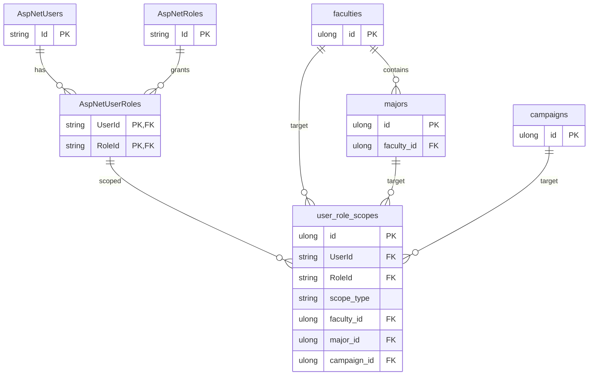
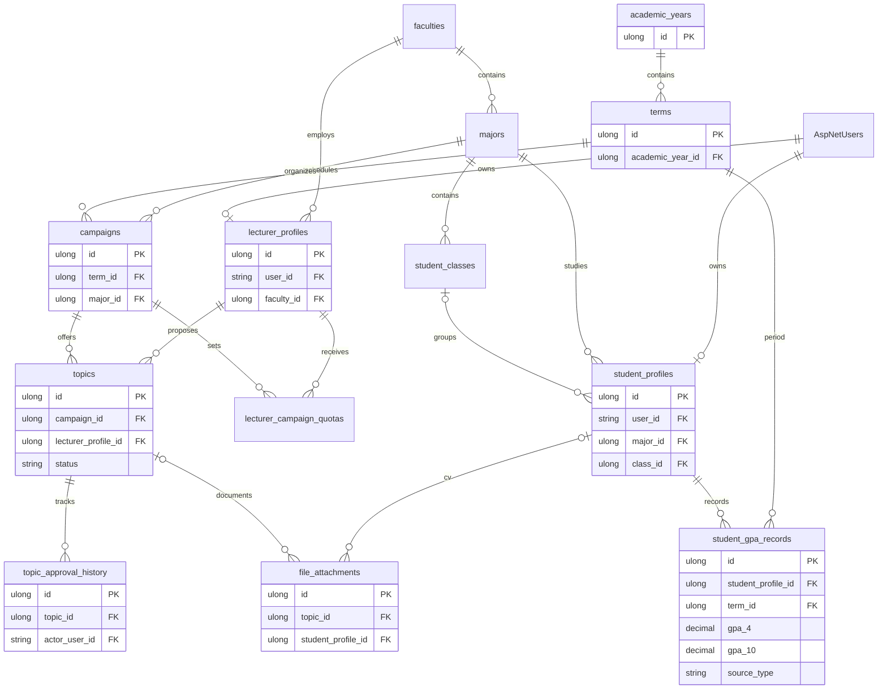
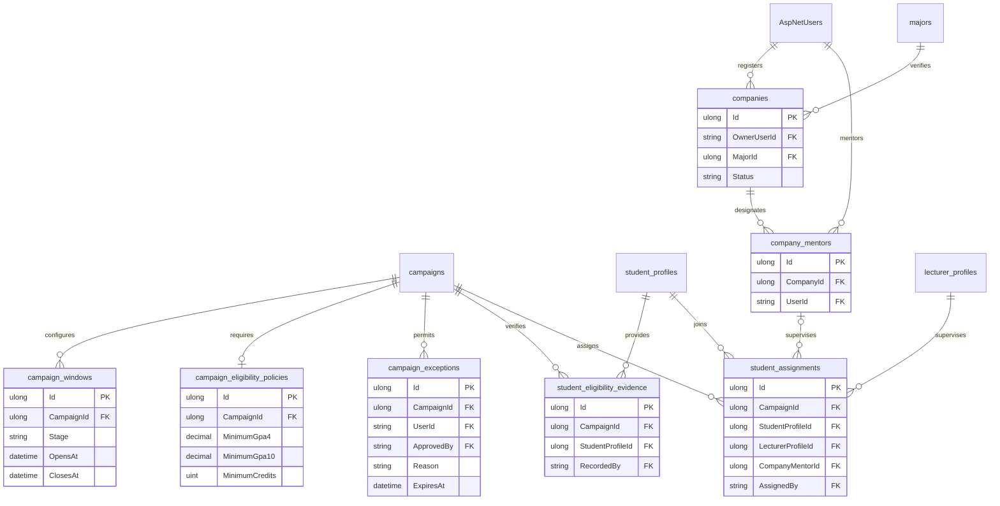
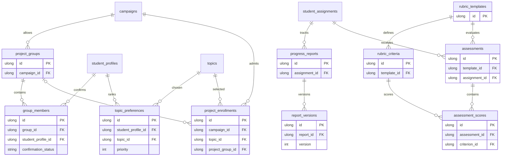

# Thiết kế dữ liệu và ràng buộc — Đề tài 36

Tài liệu thiết kế cho issue #2. Các sơ đồ đầu mô tả dữ liệu **đã triển khai** sau bản nâng cấp backlog Sprint 1–2. Sơ đồ cuối là **thiết kế dự kiến**, chưa phải các bảng có trong phần mềm.

## Tài khoản và phạm vi

Một tài khoản có nhiều vai trò. Phạm vi gắn với cặp tài khoản–vai trò đang tồn tại; khi bỏ vai trò, phạm vi đó không còn hiệu lực. GLOBAL không có mục tiêu; FACULTY/MAJOR/CAMPAIGN chỉ có một mục tiêu tương ứng. Admin quản lý hệ thống; TrainingManager và FacultyManager thực hiện nghiệp vụ trong phạm vi được cấp. Lecturer bao gồm chức năng hướng dẫn hiện có; vai trò phản biện riêng thuộc giai đoạn đánh giá sau này.

## Học vụ, hồ sơ và đề tài

GPA 4 và GPA 10 được lưu riêng theo kỳ, nguồn, người ghi và thời điểm. Không suy diễn thang này từ thang kia. GPA demo mang nguồn MANUAL; API trường chưa triển khai. Mã đề tài duy nhất trong một đợt. Nháp/Yêu cầu sửa mới được chỉnh sửa; người sở hữu mới gửi duyệt; cán bộ đúng phạm vi mới xét duyệt. File riêng tư nằm ngoài wwwroot, kiểm tra quyền ở endpoint tải.

## Lịch, điều kiện, doanh nghiệp và phân công

- Mỗi giai đoạn trong đợt có một cặp mở/đóng, nằm trong ngày đợt và không chồng lấn giai đoạn khác. Thứ tự: đăng ký → phân công → nộp → đánh giá. Thời gian nhập theo giờ Việt Nam.
- Chỉ áp dụng GPA, tín chỉ, tiên quyết khi được cấu hình; dữ liệu thiếu không được mặc định là đạt. Nguồn tín chỉ/tiên quyết và người xác nhận được lưu.
- Ngoại lệ thời hạn phải có tài khoản, giai đoạn, thời điểm hết hiệu lực, lý do và cán bộ duyệt; không mở lại đợt đã đóng/lưu trữ.
- Doanh nghiệp PENDING → APPROVED/REJECTED; quyết định có lý do, người xét và thời điểm. Ngành đăng ký quyết định phạm vi khoa xét duyệt. Đăng ký hợp tác nhiều ngành là nhiều yêu cầu riêng, hiện mã doanh nghiệp được duy nhất toàn hệ thống nên muốn đổi phạm vi cần cán bộ xử lý ở bản mở rộng.
- Một sinh viên chỉ có một phân công trong một đợt. Thực tập bắt buộc có người hướng dẫn doanh nghiệp đã xác minh; giảng viên và sinh viên phải thuộc khoa/ngành hợp lệ.
- Hạn mức đếm số **sinh viên đã phân công**, không đếm tổng chỉ tiêu đề xuất trên các đề tài. Phân công vượt quota phải được cán bộ xác nhận cùng lý do; không hạ quota dưới số đã phân công.

## Thiết kế tổng thể cho các sprint tiếp theo — chưa triển khai

Thực tập là phân công cá nhân. Nhóm đồ án chỉ được bật theo chính sách từng đợt; cần thành viên xác nhận, một SV không thuộc hai nhóm hiệu lực cùng đợt. Khi triển khai, đăng ký đề tài phải kiểm tra APPROVED ở server, thời hạn, điều kiện và quota trong giao dịch. Rubric có trọng số và phiên bản; điểm công bố/khóa tách khỏi bản nháp.

Các chính sách quy mô nhóm, điều kiện tín chỉ/tiên quyết, cách chốt GPA và quy trình phê duyệt ngoại lệ phải được giảng viên xác nhận. Giao diện hiện cho cấu hình các điều kiện được hỗ trợ, không khẳng định đây là quy định chính thức của trường.
